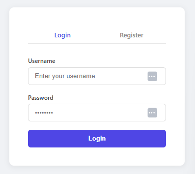
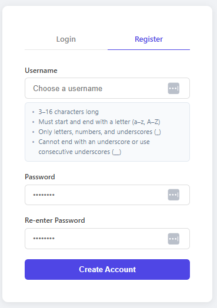

# PHP Login System

A simple login and registration system built with PHP and MySQLi. This project served as an introduction to authentication, session handling, form validation, and communicating with a database through prepared statements.

## Features

- User registration with server-side validation
- Username uniqueness checking
- Password hashing using `password_hash()`
- Login authentication using `password_verify()`
- Session-based authentication
- Protected dashboard
- Logout and session cleanup
- Flash messages for validation errors and success notifications
- Prepared statements for database queries

## Screenshots

### Login



### Registration



### Dashboard


## Project Structure

| File | Purpose |
|---|---|
| `db.php` | Loads environment variables, establishes the MySQL database connection, and configures MySQLi error reporting. |
| `index.php` | Serves as the main page, containing the login and registration forms, along with their HTML and CSS. It also displays flash messages and validation errors. |
| `login.php` | Handles the backend logic for logging in, including input validation, database lookup, password verification, and session initialization. |
| `register.php` | Handles the backend logic for registration, including input validation, username availability checking, password hashing, and inserting the new account into the database. |
| `dashboard.php` | Displays the authenticated user's dashboard and restricts access to users who are not logged in. |
| `logout.php` | Handles logout by clearing session data, expiring the session cookie, and redirecting the user with a flash message. |

## Setup

### Prerequisites

- PHP
- MySQL
- Composer

### 1. Clone the repository

```bash
git clone https://github.com/your-username/login-system.git
cd login-system
```

### 2. Install dependencies

```bash
composer install
```

### 3. Create the database

Create a MySQL database for the project, then create the following table:

```sql
CREATE TABLE users (
    user_id INT AUTO_INCREMENT PRIMARY KEY,
    username VARCHAR(16) NOT NULL UNIQUE,
    password VARCHAR(255) NOT NULL
);
```

### 4. Configure environment variables

Create a `.env` file in the project's root directory:

```env
DB_HOST=localhost
DB_USER=your_database_user
DB_PASS=your_database_password
DB_NAME=your_database_name
```

Replace the values with your actual database credentials.

### 5. Run the project

Start PHP's built-in development server from the project directory:

```bash
php -S localhost:8000
```

Open the following URL in your browser:

http://localhost:8000

## What I Learned

### Registration and Login Flow

I gained an initial understanding of how user registration and login processes work, from validating submitted inputs to checking database records and authenticating users.

### Validation and Efficiency

I learned that inexpensive checks should generally be performed before more expensive operations. For example, validating input formats and checking for empty fields before making database queries helps avoid unnecessary operations.

### Session Handling

My biggest takeaway from this project.

I learned how PHP sessions work, how session IDs are associated with cookies, and how session data can be used to carry information across different pages and HTTP requests.

This helped me understand how information such as authentication status, validation errors, and flash messages can persist between requests, even when PHP scripts are executed independently.

### Authentication

I gained a basic understanding of authentication, particularly how a system verifies a user's credentials, establishes an authenticated session, and restricts access to pages that require the user to be logged in.

## Technologies Used

- PHP
- MySQL
- MySQLi
- Composer
- PHP dotenv

## AI Usage Disclosure

AI was utilized as a supplementary reference throughout development. The backend workflow and logic were planned and thought out independently before consulting AI for syntax references, unfamiliar concepts, or vague working examples to clarify specific implementations.

The UI/UX was generated by AI, with visual directions and design preferences provided by me.

The username validation regex was approximately 50% AI-assisted.

AI primarily served as a learning reference rather than a substitute for planning the backend logic and understanding the implementation.

## Purpose

This project was built as a learning exercise to familiarize myself with PHP, database interaction, session management, and the fundamental flow of user authentication.